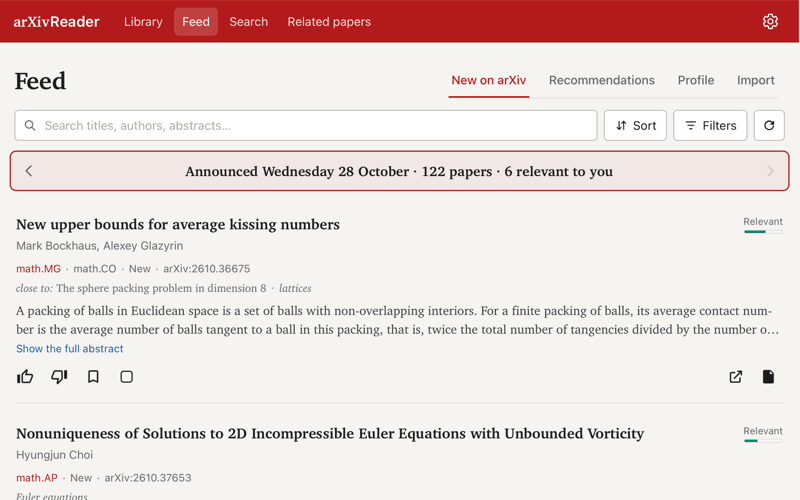

# arXivReader

**English** · [Français](README.fr.md)

A reader for arXiv papers on the Mac (Windows in preview), built for mathematics: AMS-style "paper" layout, navigable statements and
proofs, dependency graph, notes and highlights, a feed of new papers sorted by your profile, and an AI
assistant (Claude, Codex, Gemini or a local model) that only sees the text of the paper.
Everything stays on your Mac: the server only listens on 127.0.0.1. French and English interface.



**To contribute**: [CONTRIBUTING.md](CONTRIBUTING.md) and the [roadmap](ROADMAP.md).

## Install

Download `arXivReader.dmg` from the [Releases](https://github.com/seldon39/arxivreader/releases) page
(Apple Silicon Mac, macOS 13 or later), open it and drag arXivReader to Applications. The app is
self-contained (Python and its packages are included); there is nothing else to install.

- **Opening it the first time**: see below; macOS blocks it once.
- **Updates**: the app checks once a day whether a new version is available on GitHub
  (Settings → Updates); an "Update" pill then appears at the top right.
  Replace the app in Applications; your library is kept.

### If macOS refuses to open the app

The app is open source but not signed with a (paid) Apple developer account, nor notarized by Apple. On a Mac
other than the one that built it, the first opening shows a message such as *"arXivReader" Not Opened — Apple
could not verify "arXivReader" is free of malware…*. This is macOS's usual message for any app that is not
notarized; to open it anyway:

1. Double-click arXivReader in Applications; when the message appears, click **Done** (not *Move to Trash*).
2. Open **System Settings → Privacy & Security** and scroll down to the **Security** section.
3. Next to *"arXivReader" was blocked to protect your Mac*, click **Open Anyway**, then confirm with your
   password or Touch ID, and **Open**.

macOS remembers it; after an update (a new copy downloaded), it may ask once more. On macOS 14 or earlier,
right-click (or Control-click) the app in Applications → **Open** → **Open** also works.

Alternatively, in Terminal, remove the "downloaded from the Internet" mark from the app (only for an app you
downloaded from this page):

```bash
xattr -dr com.apple.quarantine /Applications/arXivReader.app
```

Making this unnecessary is on the [roadmap](https://github.com/seldon39/arxivreader/issues/1).

### Windows (preview)

A Windows version is in preview (Windows 10 or 11, 64-bit): download `arXivReader-windows.zip` from the
[Windows pre-releases](https://github.com/seldon39/arxivreader/releases), right-click it → **Extract All…**, and
double-click `arXivReader.exe` in the `arXivReader` folder. The app opens in its own window with tabs, as on the Mac
(Ctrl+T, Ctrl-click a link, the **+** of the tab bar); it relies on WebView2, the Edge engine included in Windows 10
and 11; your library is kept in `%LOCALAPPDATA%\arXivReader`.
If Windows says *Windows protected your PC*, click **More info**, then **Run anyway**: the app is not signed.
Feedback on this version is especially welcome.

## Mac app: building

`macos/build.sh` builds `dist/arXivReader.dmg` (~200 MB): an app with its own window (WebKit, like Safari)
that bundles Python and its packages. `macos/release.sh` publishes it as a new version (after bumping
`VERSION` in `app/version.py`): Git tag, push to GitHub, disk image attached.

- Quitting (⌘Q) also stops the server.
- Tabs: the Mac tab bar is always shown; its "+" (or ⌘T) opens the library in a new tab.
  ⌘-click (or middle-click) on a paper, in the library, the feed or a cross-reference, opens it in a new
  background tab (⇧⌘-click: in front). A tab dragged out of the bar becomes a window (two papers side by
  side); ⌘N opens a new window.
- **Library**: `~/Library/Application Support/arXivReader` (arXivReader menu → Show the library in Finder).
  File menu → Copy a Library…: an existing library (the `library/` folder of this project, or another Mac's)
  replaces the current one, which is set aside in a folder next to it; quit the other version first. After
  that, the two share nothing.
- **Connecting the AI assistants**: *Sign in…* / *Run in Terminal* button in the AI tab.
- Building requires the Xcode command-line tools (`swiftc`), miniforge (`conda`, Python taken from its cache)
  and an up-to-date `.venv` (its packages are copied). The build runs in `~/Library/Caches/arXivReader-build`
  (outside iCloud).

## Running from source

- **Double-click** `ArXivReader.command` in the Finder: a Terminal window opens, then the browser.
  Closing the Terminal window (or Ctrl+C) stops the app.
- **Terminal**: `./arxivreader` from this folder.

The first time, the script creates the Python environment (`.venv/`, ~1 min). The address is
http://127.0.0.1:8710/; the server only listens on this Mac (not on Wi-Fi).

## The reader

- Import by arXiv identifier or link (`2608.24719`, `arXiv:2607.17203v1`, `https://arxiv.org/abs/…`).
- The paper is read in its **official HTML version** (arxiv.org/html, otherwise ar5iv), produced by
  LaTeXML from the TeX source: formulas in MathML, statements, proofs and cross-references tagged.
  Papers without an HTML version are read in their PDF (see below).
- **AMS "paper" layout** (amsart class): text in Charter or Computer Modern, formulas rendered by
  **MathJax** (TeX rules, Computer Modern fonts, same rendering in Safari, Firefox and Chrome);
  the browser's own MathML is still available in the settings.
- **Drawing missing from the HTML version** (PSTricks…: LaTeXML keeps only its labels): a warning in its
  place, with a "See in the PDF" button.
- **Authors' affiliations** under the abstract, one line per author (name, address, email), with the
  first-page notes (funding, keywords, classification).
- **Copy formulas as LaTeX**: ⌘C on a selection copies its formulas as `$…$` (inline) and `\[…\]` (displayed)
  instead of MathJax's symbols; a "TeX" button does the same in the selection bar; ⌥-click a formula to copy
  its TeX alone.
- **Right-click** on a selection or a formula: highlight, highlight and add a note, copy as LaTeX, copy the
  text, or ask the AI assistant (elsewhere, the system menu stays).
- **Hover preview** of any cross-reference (theorem, equation, citation, footnote); click to go there,
  with a "Back" button.
- **Collapsible proofs**; handwritten proofs ("*Proof.* … □") are detected automatically.
- **Structure panel**: list of statements (filtered by type), dependencies of a statement
  (uses / used by / cites, full chain), dependency **graph** (can be shown full screen).
- Flags any **invisible text** (white, tiny, hidden) the paper may contain.
- Resumes reading where you left off; settings: French/English, light/dark/system theme,
  text size, reading width (from "Narrow" to "Full" for large screens), proofs collapsed by default; text
  size and width also in the reader's toolbar (A−/A+ and two width buttons).
- Layout adapted to the window width: 3 columns (≥ 1280 px), 2 (≥ 900 px), 1 column with drawers.

Dependencies come from the cross-references (`\ref`, `\eqref`, `\cite`) in a statement and in its proof:
an argument used without an explicit reference does not show up.

## Search

The "Search" tab queries all of arXiv (public API at export.arxiv.org/api) with the options of its advanced
search: criteria by field (all fields, title, author, abstract, comments, journal reference, category,
report number, identifier) combined with AND / OR / NOT, "exact phrase" in quotes, categories (your feed
categories are offered, others can be added), cross-lists included or not, submission period (past
12 months, a year, a date range), sorted by relevance, by date, or "For you" (arXiv's 200 most relevant
results, re-ranked by your profile like the feed), in pages of 25 results. Results look like the feed
(relevance to your profile, 👍 / 👎, add to library, ⌘-click for a new tab). Not offered, because arXiv's
API does not support them: DOI, ORCID, MSC/ACM classes, license. At most one request every 3 s, as arXiv asks.

## Related papers

The "Related papers" tab (in the spirit of Connected Papers) shows the 40 papers closest to a paper, chosen by
its arXiv link, from the library (menu, or the ⊙ button of each card), or dropped in the frame. Candidates: its
references, the papers citing it and those these neighbours often cite (Semantic Scholar); closeness: shared
references and papers citing them together, relative to the size of the lists (a classic cited everywhere does
not crowd out a close work). Tabs: the graph, prior works (those most cited by the papers in the graph: often
the seminal works) and derivative works (those citing the most papers in the graph: surveys, recent work);
choosing one highlights the papers in the graph linked to it. Graph: the closer two papers, the nearer they are drawn; only each paper's strongest links are drawn, all those of the chosen paper appear; size by
citations, colour by year (the legend gives the years), a check-mark badge for those in the library; pinch (or ⌘ + scroll, or the − + buttons) to zoom, drag the background to move; the graph can be enlarged to the whole window (Esc to return, keys + − 0). The
chosen paper can be read, added to the library, filed in a folder (or dragged onto one), or become the start of a
new graph. A graph is kept fifteen days ("Rebuild" to redo it). Building takes from a few seconds to several
minutes without a Semantic Scholar API key (shared quota); it runs in the background, shows its current step, and "Cancel" stops it.

## Folders

In the library, a row of folders comes before the full list of papers (which stays visible).
Clicking a folder unfolds it just below, with its papers; "Rename", "Delete folder" (can be undone; its
papers stay in the library) and "Close"; its "Sort" and "Filters" buttons offer the same
choices as the library's (without the folder filter), sorting adding relevance to your profile (computed as for the feed, a paper not being compared with itself),
and a keyword search narrows the folder's list (title, authors, abstract, identifier, categories). The folder button of each paper opens "File in…":
folders to tick, or a new folder. A paper can also be dragged (by its title) onto a folder or into the open
folder, from the library, the feed, the search, another arXivReader window, or as an arXiv link from elsewhere
(Safari…); a paper not yet in the library is imported first. Dropped on the general list ("Other papers"), a paper
from the feed or the search is added to the library, outside folders. A dragged paper that lingers on a tab of the
tab bar opens that tab (to drop it in its page); dropped on "Library" at the top, it is added and the library opens
in a new tab; on "Related papers", its graph opens in a new tab. The ☐ button of each card (library, folders, feed,
search) selects several papers: a bar at the bottom offers "File in…", and dragging one of them takes them all.
Once papers are filed, the general list becomes "Other papers" (those in no folder); the search field and "Filters",
above the folders, cover the whole library, and their results come first, above the folders. A paper can be in several folders, shown at the end of its line;
"Filters" can also narrow the list to one or more folders.
"Sort" orders papers by last read, added, published, or alphabetically (title or first author, A → Z or
Z → A, folders then being sorted by name in the same order).

## Zotero

Settings, "Zotero" section: with a personal Zotero web API key (created at zotero.org/settings/keys/new, library
access with write access), the library and folders synchronise both ways with an "arXivReader" collection in
Zotero, each folder being a subcollection. A paper added, filed or removed on one side is on the other; a Zotero
item filed in "arXivReader" with an arXiv identifier is imported from arXiv. No Zotero item is ever deleted: a removed
paper is only taken out of these collections (its other collections stay), and a paper already in Zotero is reused,
not duplicated. Deleting a folder deletes its subcollection (not its items), and the other way round. Automatic
synchronisation ("Synchronise automatically" setting) shortly after each change and every ten minutes, or
"Synchronise now". To be safe, an automatic synchronisation that would remove many papers at once (or sees
subcollections vanish) changes nothing and waits for "Synchronise now". `ARXIVREADER_NO_ALERTS=1` also turns
automatic synchronisation off (testing).

## Published in a journal

In the library and the feed, "Filters" → *Journal publication* keeps the papers published in a journal, or those not
reported as such; the journal shows on the card ("Published: …"). From the reference (or DOI) given on arXiv by
the authors, otherwise from Semantic Scholar, queried in batches and asked again after 30 days for a paper
still not reported. Many authors never update arXiv: a paper not reported may still be published.

## First launch

The interface starts in the language of macOS (French if it comes first, otherwise English); the assistant
below lets you switch between French and English at once, and so do the settings later.
When the library and profile are empty (fresh installation), an assistant finds your papers on arXiv (arXiv
author identifier or ORCID, the safest; or name: namesakes with another first name or in another field are
unticked, untick the others yourself), suggests the feed categories (from your papers) and
the authors to follow (coauthors, authors your papers cite most), then fills the profile; it can also add your
papers to the library. Run it again from the Profile ("Getting-started assistant").

## Feed

**Feed** menu at the top, four tabs:
- **New on arXiv**: daily announcements of the categories you follow (math.DG, math.CV, math.SP,
  math-ph by default, editable in the settings), **sorted by relevance to your profile**, with the reason
  shown ("followed author", "close to …", keyword); papers of low relevance are reduced to one line (click
  to unfold). Clicking the title opens the paper without adding it to the library (cache cleared after
  30 days without reading); the **bookmark** adds it to or removes it from the library (also in the reader's
  toolbar). At the top: new papers by your **followed authors**, even outside your categories.
  "arXiv order" sorting is available. 👍 / 👎 refine the ranking. The arrows next to the announcement date
  go back to earlier days; days older than a week come from arXiv's search API, which gives new and
  cross-listed papers but not replacements.
- **Recommendations**: Semantic Scholar (public API, no account needed), based on your profile and your 👍.
- **Profile**: your papers, reference papers and books, followed authors, keywords, in collapsible
  sections (closed by default, state kept) with a search in each.
  "Prefill from the library" builds it from the library and from the bibliographies of your papers
  (authors cited at least twice, full first name looked up on arXiv; cited books; keywords).
  The references of your papers are also used, in the background.
- **Import**: paste an e-mail from Scholar Inbox or Semantic Scholar, a list of links or a BibTeX
  export; arXiv identifiers are found and imported in one go.

How relevance is computed (app/relevance.py): closeness in vocabulary (TF-IDF of titles and abstracts)
and in meaning (Semantic Scholar SPECTER vectors, compared within the day's batch), best match in the
profile; + followed authors, keywords; − closeness to 👎 papers.
A Semantic Scholar API key (free, optional) avoids request limits.

## Where the proofs are

A proof is attached to its statement when it follows it (*proof* environment or "*Proof.* … □"),
when its title refers to it ("Proof of Lemma 4.4"), or when a whole section is devoted to it
("4.2. Proof of Theorem 1.3"; the statement then shows "→ Proof in § 4.2"). A statement whose title
cites a reference ("Theorem 3.2 ([12, Theorem 4.3])") is marked *cited*; a statement justified by the
sentence before it ("The following corollary is a consequence of (2.6)") or after it ("This follows from
Lemma 2.1") is marked *justified in the text*. Otherwise: *proof not found*.
If the detection is wrong or finds nothing: Dependencies tab, **Locate the proof** — a section of the
paper, a passage chosen in the text (click the first then the last paragraph), *immediate* or
*admitted*; *Automatic detection* undoes the choice. The choice is saved with the paper's notes and is
used for the dependencies and by the AI assistant.
Papers already imported are re-analysed automatically when this analysis changes.

## From one paper to another

When a bibliography entry is a paper read here (same arXiv identifier, same DOI, or title found in the
entry), hovering "[12, Theorem 4.3]" shows Theorem 4.3 of that paper, with a button to open it at that
place; in the bibliography, an "Open the paper" pill.
arXiv identifiers in the bibliography ("arXiv:2101.00001") open the cited paper in a new tab (⌘-click: in
the background), whether it is in the library or not; the paper you were reading stays in its own tab.

## Papers without an HTML version

When arXiv has no HTML version, the paper is read in its PDF, shown inside the reader.
The PDF is displayed by pdf.js (Mozilla), bundled with the app: it knows which page is being read, so
switching between PDF and HTML ("HTML | PDF" selector) lands at the same place, and the reading position
is kept while reading the PDF too. Scripts contained in PDFs are never run.
Statements, proofs, dependencies, graph and bibliography are taken from the TeX source (`\newtheorem`
environments, simulated numbering, `\ref`/`\eqref`/`\cref`); choosing a statement goes to its page in the
PDF (hyperref anchors, otherwise a text search). Compared with the HTML version on 42 papers: 99 % of the
statements and 97 % of the links are found. For a paper imported before this feature: "Update from arXiv"
button on its card in the library.

## Citations of your papers

Once a day, Semantic Scholar gives the papers citing those of your profile ("My papers"); new ones appear
under "Citing your papers" in the feed, count in the badge and, if the setting allows, trigger a macOS
notification.

## Followed authors: alerts

While arXivReader is running, it checks every 3 hours (and one minute after launch) for new papers by the
followed authors of your profile: a macOS notification for each one (setting "Notify me when a followed
author posts"), a badge on "Feed", and an "Unseen" label on the card until it has been shown. Clicking the
macOS notification opens Script Editor (a limitation of osascript): just close it and go to the feed.

## Notes and annotations

- **Highlight**: select a passage (formulas included); a bar offers 4 colours and "add a note".
  Clicking a highlight lets you change its colour or its note, or delete it.
- **Statements and proofs**: the note icon in the margin (on hover) opens a note and, for a statement,
  the reading state *understood / to review / checked* (shown in the title and in the list of statements).
- **Notes tab** of the panel: reading progress, the paper's reading sheet, all annotations in the order of
  the paper (a click takes you there).
- Notes in Markdown (**bold**, *italics*, lists, quotes) with formulas `$…$`, `$$…$$`, saved automatically.
  An annotated paper is never removed from the cache.
- **Export**: "Export notes (Markdown)" at the bottom of the Notes tab (reading sheet, statements and proofs with
  their state, highlighted passages by section, formulas in LaTeX); Settings > Reading: all notes, one file per
  paper, in a .zip archive (Downloads folder).

## Claude on the paper

- **Sign in, once**: double-click `Connecter Claude.command` (or `./arxivreader login`).
  The Claude sign-in page opens in the browser; your Claude subscription is used, with no API key
  (usage counts towards its limits).
- **Statement** (Dependencies tab, or margin note): *Explain*. **Proof**: *Detail the proof*
  (numbered steps, added arguments marked **[added]**, doubtful points **⚠**) and *Audit the proof*
  (verdict, issues with their severity, hypotheses used, dependencies).
- **Passage**: select it, then ✦; you can add a question. **Whole paper**: structured summary,
  critical review, or a free question; *Follow-up* to continue a conversation.
  *Send to Claude* (or to ChatGPT, to Gemini) opens a new conversation in the assistant's app or website,
  with the paper's reference, and copies its full text to the clipboard.
- Answers stream live, formulas are rendered, references ("Lemma 2.3", "(2.11)") are clickable;
  *Add to my notes* copies them into the note of the statement or proof (otherwise into the reading sheet).
  Model (Opus, Fable, Sonnet, Haiku… depending on your subscription) and reasoning level chosen in the AI tab
  or the settings; likewise for Codex and Gemini, from the list of your account or key. Answers are kept
  with the paper.
- **Annotations suggested by Claude**: *Annotate* button on a statement, or any request such as
  "highlight… / annotate…". Claude attaches a list of annotations (passages quoted word for word, colour,
  note; notes on a statement or a proof): each passage is located in the paper, you tick what you keep,
  *Apply* creates them (marked "Claude") and *Cancel* removes them. Claude never writes anything itself.
- Claude only receives the text of the paper (invisible text removed) and the request: no tools, no files,
  no network, no commands, no personal Claude Code settings; nothing is kept on the Claude Code side.

### Other assistants (Settings → AI assistant)

For a colleague without a Claude subscription, the AI tab also works with:

- **Codex** (OpenAI, ChatGPT account): `npm install -g @openai/codex`, then `codex login`. Called through
  `codex exec` without commands or web search, without personal settings or saved session, in an empty
  folder, read-only sandbox.
- **Gemini** (Google): through the Gemini API, with a key created on [Google AI Studio](https://aistudio.google.com/apikey)
  and pasted in Settings → AI assistant; the model is chosen among those the key allows. A plain request,
  with no tools at all. Limited free tier (on which Google may use the exchanges to improve its models),
  otherwise pay as you go. Gemini CLI no longer accepts free Google accounts since June 2026.
- **Local model** (Ollama, LM Studio, llama.cpp…: any OpenAI-compatible server on `127.0.0.1`): nothing
  leaves the computer. Allow a context of at least 32,000 tokens (`OLLAMA_CONTEXT_LENGTH=32768 ollama serve`);
  only the beginning of long papers (~120,000 characters) is sent. Small models are much less reliable
  in mathematics.

Codex is an agent: its tools are switched off through its own settings, a weaker guarantee than for Claude
and Gemini (called with no tools at all). Its integration follows its documentation (October 2026 version)
but has not been tried with a real account.

## Security

- Server on `127.0.0.1` only; foreign host names and requests from other sites are refused.
- Paper HTML is cleaned (scripts, forms, `javascript:` links removed) and a CSP policy forbids any script
  coming from the paper.
- Data (SQLite database + one folder per paper) in `~/Library/Application Support/arXivReader` for the app,
  in `library/` when run from source. Elsewhere, only what you ask for: exported notes (Downloads folder) and,
  if you turn the weekly check on, its log (`~/Library/Logs`) and its job (`~/Library/LaunchAgents`).
- Outgoing connections: arXiv (papers, new papers), Semantic Scholar (recommendations, related papers), GitHub
  (once a day, number of the latest version; can be turned off), the chosen AI assistant, Zotero if a key is
  given; `./arxivreader check` also calls each of them.

## Maintenance

The application depends on services it does not control (arXiv and its LaTeXML pages, Semantic Scholar, Zotero,
the AI assistants, GitHub) and on WebKit, which changes with macOS. The tests (`tests/`) simulate these services;
`./arxivreader check` really calls them, one minimal request each, and checks the shape of the answers (✓ fine,
✗ changed or down, – not checked: no key, quota reached). It also reports a change of macOS or WebKit since the
previous time, with the points to review by hand. `./arxivreader check --weekly` runs it every Monday at 10 am
through the installed application (macOS notification if something is wrong; log in
`~/Library/Logs/arXivReader-check.log`); `--no-weekly` stops it.

Versions: `requirements.txt` lists the wanted packages, `requirements.lock` their exact, tested versions, which
`.venv` installs and the application ships; `macos/build.sh` refuses to build if `.venv` differs. To update a
package, deliberately and one at a time: `.venv/bin/pip install -U <package>`, the tests, then `./arxivreader lock`
(and commit). MathJax and pdf.js are pinned in `static/vendor`.

For an AI assistant in charge of maintenance: `MAINTENANCE.md` (in French: rules, work loop, release, what to do
when a service changes, known pitfalls), read automatically by Claude Code (`CLAUDE.md`) and Codex (`AGENTS.md`).

## Code layout

```
app/            Python server (FastAPI)
  arxiv.py      identifiers, metadata (arXiv API), HTML download
  sanitize.py   HTML cleaning
  structure.py  table of contents, statements, proofs, dependencies, bibliography
  texsource.py  reading the TeX source (class options, font, list labels)
  feed.py       new arXiv papers (RSS, OAI-PMH), Semantic Scholar recommendations, identifier detection
  journals.py   journal where a paper appeared (arXiv, Semantic Scholar)
  search.py     search across arXiv (Search tab); related.py: related papers (graph); zotero.py: Zotero synchronisation; check.py: check of the external services; onboarding.py: getting-started assistant; export.py: notes export
  folders.py    library folders
  profile.py    research profile, prefill, followed authors; relevance.py: relevance ranking
  annotations.py  highlights, notes, reading state
  ai.py         paper text and instructions for Claude, called without tools (Claude Agent SDK)
  crossrefs.py  references that are papers read here; citations.py: papers citing yours
  texstructure.py  structure from the TeX source and PDF pages (papers without an HTML version)
  providers.py  other assistants: Codex (command line), Gemini (API), local model (Ollama, LM Studio)
  library.py    importing a paper; db.py: SQLite database; main.py: web routes
macos/          Mac app: main.swift (window, tabs, server), icon.swift, build.sh, release.sh
static/         interface (HTML, CSS, JavaScript with no build step);
                vendor/mathjax (MathJax 3.2.2), vendor/pdfjs (pdf.js 6.3.289, Apache 2.0)
                and fonts/ (Latin Modern) copied locally
tests/          offline tests: .venv/bin/python -m unittest discover tests
```

## Inspiration

arXivReader was partly inspired by Mingchen Xia's [arXivpecker](https://github.com/MingchenXia/arXivpecker),
a local, AI-assisted reader for mathematics papers. The two projects share no code: arXivReader was written
independently (Python, arXiv's LaTeXML HTML and MathJax), with its own choices — rendering the official
HTML, a daily feed sorted by your profile, an AI assistant with no tools or network, an installable Mac app.

## License

MIT.
