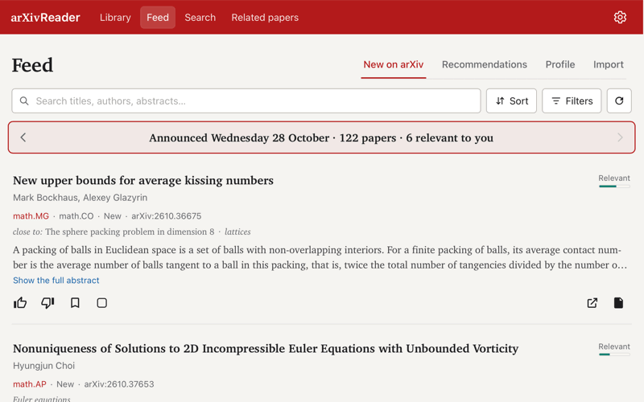

# arXivReader

**English** · [Français](README.fr.md)

A reader for arXiv papers built for mathematics: AMS-style "paper" layout, navigable statements and proofs,
dependency graph, notes and highlights, a feed of new papers sorted by your profile, related-papers graphs, and an
optional AI assistant (Claude, Codex, Gemini or a local model) that only sees the text of the paper: questions,
summaries and critical reviews, optionally cross-checked by two assistants, chapter by chapter for books, section by section for papers. French and
English interface.

It runs on **macOS** and **Windows** (apps to download) and on **Linux** (from the source code). Everything stays
on your computer: the server only listens on 127.0.0.1.



**To contribute**: [CONTRIBUTING.md](CONTRIBUTING.md) and the [roadmap](ROADMAP.md).

## Install

| System | Download | Requirements |
|---|---|---|
| macOS | `arXivReader.dmg` from the [latest release](https://github.com/seldon39/arxivreader/releases/latest) | Apple Silicon Mac, macOS 13 or later |
| Windows | `arXivReader-setup.exe` (installer) or `arXivReader-windows.zip` (portable) from the [latest release](https://github.com/seldon39/arxivreader/releases/latest) | Windows 10 or 11, 64-bit |
| Linux | from the source code: see [Linux](#linux) | Python 3.12 or later |

The apps are self-contained (Python and its packages are included): there is nothing else to install. They check
once a day whether a new version is out (Settings → About) and then show an "Update" pill at the top right; your
library is kept when you update.

### macOS

Open `arXivReader.dmg` and drag arXivReader to Applications. To update, replace the app in Applications (quit it
first). The first time, macOS blocks the app once: see below.

#### If macOS refuses to open the app

The app is open source but not signed with a (paid) Apple developer account, nor notarized by Apple. On a Mac
other than the one that built it, the first opening shows a message such as *"arXivReader" Not Opened — Apple
could not verify "arXivReader" is free of malware…*. This is macOS's usual message for any app that is not
notarized; to open it anyway:

1. Double-click arXivReader in Applications; when the message appears, click **Done** (not *Move to Trash*).
2. Open **System Settings → Privacy & Security** and scroll down to the **Security** section.
3. Next to *"arXivReader" was blocked to protect your Mac*, click **Open Anyway**, then confirm with your
   password or Touch ID, and **Open**.

macOS remembers it; after an update (a new copy downloaded), it may ask once more. On macOS 14 or earlier,
right-click (or Control-click) the app in Applications → **Open** → **Open** also works.

Alternatively, in Terminal, remove the "downloaded from the Internet" mark from the app (only for an app you
downloaded from this page):

```bash
xattr -dr com.apple.quarantine /Applications/arXivReader.app
```

Making this unnecessary is on the [roadmap](https://github.com/seldon39/arxivreader/issues/1).

### Windows

Run **`arXivReader-setup.exe`**: it installs arXivReader for your user account (no administrator rights needed), adds
it to the Start menu (and to the desktop if you tick the box), and lists it in **Settings → Apps** with an
**Uninstall** button. To update, run the new installer: it updates the app in place. Prefer no installation (e.g. on
a USB stick)? Use **`arXivReader-windows.zip`** instead: right-click → **Extract All…**, then double-click
`arXivReader.exe` in the `arXivReader` folder; to update, replace that folder.

The app opens in its own window with tabs, as on the Mac
(Ctrl+T, Ctrl-click a link, the **+** of the tab bar); links to other sites open in your usual browser. Your library
is kept in `%LOCALAPPDATA%\arXivReader`.

- If Windows says *Windows protected your PC*, click **More info**, then **Run anyway**: the app is open source but
  not signed. Your antivirus may also ask for confirmation the first time.
- The app relies on WebView2, the Edge engine included in Windows 10 and 11 (if a stripped-down Windows lacks it,
  the app says where to install it).
- Updating or uninstalling never touches your library, which lives elsewhere.

### Linux

No packaged app yet: arXivReader runs from the source code, in your browser. You need Python 3.12 or later with its
`venv` module (on Debian/Ubuntu, the `python3-venv` package), then:

```bash
git clone https://github.com/seldon39/arxivreader.git && cd arxivreader && ./arxivreader
```

The first time, the script creates the Python environment (`.venv/`, ~1 min), then opens http://127.0.0.1:8710/
with `xdg-open`; Ctrl+C stops the app. Another Python: `PYTHON=python3.14 ./arxivreader`. To update: `git pull`, then
`./arxivreader` again (the app says when a new version is out). The tests run on Linux with Python 3.12, 3.13 and
3.14 at every push.

## Mac app: building

`macos/build.sh` builds `dist/arXivReader.dmg` (~200 MB): an app with its own window (WebKit, like Safari)
that bundles Python and its packages. `macos/release.sh` publishes it as a new version (after bumping
`VERSION` in `app/version.py`): Git tag, push to GitHub, disk image attached.

- Quitting (⌘Q) also stops the server.
- Tabs: the Mac tab bar is always shown; its "+" (or ⌘T) opens the library in a new tab.
  ⌘-click (or middle-click) on a paper, in the library, the feed or a cross-reference, opens it in a new
  background tab (⇧⌘-click: in front). A tab dragged out of the bar becomes a window (two papers side by
  side); ⌘N opens a new window.
- **Menus** built from the app's functions; what does not apply is greyed out, and labels follow the state ("Show HTML",
  "Hide Contents", "Zoom In" in the PDF…). **File**: import from arXiv (⌘O) or a PDF / TeX file (⇧⌘O), add the paper being
  read to the library, copy its BibTeX, open it on arXiv, show its PDF in the Finder, export the whole library as .bib
  ("Show the library in Finder" opens the folder of the papers). **Edit**: find in the paper (⌘F), in the library (⌥⌘F),
  bookmark (⌘D). **View**: HTML / PDF (⌥⌘P), contents (⌃⌘S), panel tabs (⌥⌘1…⌥⌘5), panel (⌥⌘0), fold the proofs, zoom, text
  width. **Go**: Library, Feed, Search, Related papers (⌃⌘1…⌃⌘4), previous / next page, statements (j / k / p recalled).
  **Help**: keyboard shortcuts.
- Asks before quitting if an answer from the AI assistant is still coming; the tabs of the last session are reopened at
  launch (only the tab shown is loaded); "Reopen Closed Tab" (⌘⇧T); ⌘+ ⌘− ⌘0 (text size, or PDF zoom); ⌘1…⌘9 (tab by number);
  downloads are saved without bringing the Finder forward; after a page that keeps crashing, a message and a button.
- **Show All Tabs** button at the right of the title bar, above the + of the tabs (also ⇧⌘\\); in full screen the
  title bar and the tabs stay in place above the page instead of sliding over it.
- **Library**: `~/Library/Application Support/arXivReader` (File menu → Show the Library in Finder, which opens the folder of the papers).
  File menu → Copy a Library…: an existing library (the `library/` folder of this project, or another Mac's)
  replaces the current one, which is set aside in a folder next to it; quit the other version first. After
  that, the two share nothing.
- **Connecting the AI assistants**: *Sign in…* / *Run in Terminal* button in the AI tab.
- Building requires the Xcode command-line tools (`swiftc`), miniforge (`conda`, Python taken from its cache)
  and an up-to-date `.venv` (its packages are copied). The build runs in `~/Library/Caches/arXivReader-build`
  (outside iCloud).

## Running from source

On Linux, see [Linux](#linux) above. On a Mac (development):

- **Double-click** `ArXivReader.command` in the Finder: a Terminal window opens, then the browser.
  Closing the Terminal window (or Ctrl+C) stops the app.
- **Terminal**: `./arxivreader` from this folder.

The first time, the script creates the Python environment (~1 min) in `.venv.nosync/`, which iCloud does not
sync, with `.venv` as a link to it. The address is http://127.0.0.1:8710/; the server only listens on this computer (not on Wi-Fi).

## The reader

- Import by arXiv identifier or link (`2608.24719`, `arXiv:2607.17203v1`, `https://arxiv.org/abs/…`).
- The paper is read in its **official HTML version** (arxiv.org/html, otherwise ar5iv), produced by
  LaTeXML from the TeX source: formulas in MathML, statements, proofs and cross-references tagged.
  Papers without an HTML version are read in their PDF (see below).
- **AMS "paper" layout** (amsart class): text in Charter or Computer Modern, formulas rendered by
  **MathJax** (TeX rules, Computer Modern fonts, same rendering in Safari, Firefox and Chrome);
  the browser's own MathML is still available in the settings.
- **Font commands unknown to LaTeXML** (`\EuScript`, `\scr`, `\EuFrak`, `\Bbb`…), which arXiv's HTML leaves as raw
  text before the letter: the letter is shown in the intended calligraphic, script, Fraktur or blackboard font. A
  formula whose text contains a reference or a citation (`\text{by \eqref{…}}`) is typeset by MathJax too, and the
  reference stays a link.
- **Drawing missing from the HTML version** (PSTricks…: LaTeXML keeps only its labels): a warning in its
  place, with a "See in the PDF" button.
- **Authors' affiliations** under the abstract, one line per author (name, address, email), with the
  first-page notes (funding, keywords, classification).
- **The paper in the databases**: next to the DOI chip of the header, the "MathSciNet" and "zbMATH" chips look the
  paper up in the browser (zbMATH by DOI, otherwise by arXiv number; MathSciNet with authors, title, journal
  reference and DOI in its citation search). These are searches: the site says itself when it finds nothing.
- **Copy formulas as LaTeX**: ⌘C on a selection copies its formulas as `$…$` (inline) and `\[…\]` (displayed)
  instead of MathJax's symbols; a "TeX" button does the same in the selection bar; ⌥-click a formula to copy
  its TeX alone.
- **Right-click** on a selection or a formula: highlight, highlight and add a note, copy as LaTeX, copy the
  text, or ask the AI assistant (elsewhere, the system menu stays).
- **Hover preview** of any cross-reference (theorem, equation, citation, footnote); click to go there,
  with a "Back" button.
- **Collapsible proofs**; handwritten proofs ("*Proof.* … □") are detected automatically.
- **Structure panel**: list of statements (filtered by type), dependencies of a statement
  (uses / used by / cites, full chain), dependency **graph** (can be shown full screen).
- Flags any **invisible text** (white, tiny, hidden) the paper may contain.
- Resumes reading where you left off; settings: French/English, light/dark/system theme,
  text size, reading width (from "Narrow" to "Full" for large screens), proofs collapsed by default; text
  size and width also in the reader's toolbar (A−/A+ and two width buttons).
- Layout adapted to the window width: 3 columns (≥ 1280 px), 2 (≥ 900 px), 1 column with drawers.
- **Long papers stay light**: sections more than one screen away from the window are not drawn, and drawn again
  before they come into view (on a long paper full of formulas, about a third of the memory).
- **Reading position never lost**: also in imported PDFs and TeX files, to the line in HTML, saved when the tab is closed.
- **Back / forward**: ⌥← and ⌥→ return to the place you left, in HTML and in the PDF (internal links of the PDF included).
- **Reading keys**: `j` / `k` next / previous statement (also `]` / `[`), `p` fold or unfold the proof of the statement
  being read, `?` the list of shortcuts.
- **"Proof of …" banner** while a proof is being read (hover: the statement; click: go to it); the matching statement is
  marked in the panel.

Dependencies come from the cross-references (`\ref`, `\eqref`, `\cite`) in a statement and in its proof:
an argument used without an explicit reference does not show up.

## Search

The "Search" tab queries all of arXiv (public API at export.arxiv.org/api) with the options of its advanced
search: criteria by field (all fields, title, author, abstract, comments, journal reference, category,
report number, identifier) combined with AND / OR / NOT, "exact phrase" in quotes, categories (your feed
categories are offered, others can be added), cross-lists included or not, submission period (past
12 months, a year, a date range), sorted by relevance, by date, or "For you" (arXiv's 200 most relevant
results, re-ranked by your profile like the feed), in pages of 25 results. Results look like the feed
(relevance to your profile, 👍 / 👎, add to library, ⌘-click for a new tab). Not offered, because arXiv's
API does not support them: DOI, ORCID, MSC/ACM classes, license. At most one request every 3 s, as arXiv asks.

## Related papers

The "Related papers" tab (in the spirit of Connected Papers) shows the 40 papers closest to a paper, chosen by
its arXiv link, from the library (menu, or the ⊙ button of each card), or dropped in the frame. Candidates: its
references, the papers citing it and those these neighbours often cite (Semantic Scholar); closeness: shared
references and papers citing them together, relative to the size of the lists (a classic cited everywhere does
not crowd out a close work). Tabs: the graph, prior works (those most cited by the papers in the graph: often
the seminal works) and derivative works (those citing the most papers in the graph: surveys, recent work);
choosing one highlights the papers in the graph linked to it. Graph: the closer two papers, the nearer they are drawn; only each paper's strongest links are drawn, all those of the chosen paper appear; size by
citations, colour by year (the legend gives the years), a check-mark badge for those in the library; pinch (or ⌘ + scroll, or the − + buttons) to zoom, drag the background to move; the graph can be enlarged to the whole window (Esc to return, keys + − 0). The
chosen paper can be read, added to the library, filed in a folder (or dragged onto one), or become the start of a
new graph. A graph is kept fifteen days ("Rebuild" to redo it). Building takes from a few seconds to several
minutes without a Semantic Scholar API key (shared quota); it runs in the background, shows its current step, and "Cancel" stops it.

## Folders

In the library, a row of folders comes before the full list of papers (which stays visible).
Clicking a folder unfolds it just below, with its papers; "Rename", "Delete folder" (can be undone; its
papers stay in the library) and "Close"; its "Sort" and "Filters" buttons offer the same
choices as the library's (without the folder filter), sorting adding relevance to your profile (computed as for the feed, a paper not being compared with itself),
and a keyword search narrows the folder's list (title, authors, abstract, identifier, categories). The folder button of each paper opens "File in…":
folders to tick, or a new folder. A paper can also be dragged (by its title) onto a folder or into the open
folder, from the library, the feed, the search, another arXivReader window, or as an arXiv link from elsewhere
(Safari…); a paper not yet in the library is imported first. Dropped on the general list ("Other papers"), a paper
from the feed or the search is added to the library, outside folders. A dragged paper that lingers on a tab of the
tab bar opens that tab (to drop it in its page); dropped on "Library" at the top, it is added and the library opens
in a new tab; on "Related papers", its graph opens in a new tab. The ☐ button of each card (library, folders, feed,
search) selects several papers: a bar at the bottom offers "File in…", and dragging one of them takes them all.
Once papers are filed, the general list becomes "Other papers" (those in no folder); the search field and "Filters",
above the folders, cover the whole library, and their results come first, above the folders. A paper can be in several folders, shown at the end of its line;
"Filters" can also narrow the list to one or more folders.
"Sort" orders papers by last read, added, published, or alphabetically (title or first author, A → Z or
Z → A, folders then being sorted by name in the same order).

## Searching the library

The library's search field ("Search the library: titles, authors, full text, notes…") filters the cards on titles,
authors and other metadata, and, from 3 characters on, also searches the text of the papers and your notes. Below the
filters, "In the text and notes (n)" lists the matches grouped by paper: notes and highlights first, then passages of
the text, at most three per paper. Each match gives its kind (Note, Highlight, Statement, Text), the statement or
section it is in (or "PDF, p. n") and an extract with its formulas; a click opens the paper at that place, and a
highlight, a free note or an annotation of the PDF opens in its own view (HTML or PDF). The search ignores accents and
case, finds words inside formulas (their TeX), covers imported PDFs (by page) and the notes of older versions of a
paper (marked "· version k"). At most 200 results. Several words must all be in the paper; "an exact phrase" in quotes
is looked for as written; formulas are found whatever the spaces and braces; papers read from their PDF are searched
too, TeX source included.

## BibTeX and references

- **Copy BibTeX** for the paper being read, on library cards, for a selection or a folder ("Export as .bib"), and on a
  bibliography reference recognised by its arXiv identifier or DOI. Built offline from what is stored: `@article` only
  when the journal is known, nothing is invented.
- **References to the library**: "+ Library" on a reference that has an arXiv identifier; "Add the n arXiv references to
  the library", under the title of the bibliography (one by one, can be stopped). These two buttons, like the reader's
  bookmark and "+ Library" in a reference preview, ask where to file the paper: the library only, an existing folder or a
  new folder.

## Zotero

Settings, "Zotero" section: with a personal Zotero web API key (created at zotero.org/settings/keys/new, library
access with write access), the library and folders synchronise both ways with an "arXivReader" collection in
Zotero, each folder being a subcollection. A paper added, filed or removed on one side is on the other; a Zotero
item filed in "arXivReader" with an arXiv identifier is imported from arXiv. No Zotero item is ever deleted: a removed
paper is only taken out of these collections (its other collections stay), and a paper already in Zotero is reused,
not duplicated. Deleting a folder deletes its subcollection (not its items), and the other way round. Automatic
synchronisation ("Synchronise automatically" setting) shortly after each change and every ten minutes, or
"Synchronise now". To be safe, an automatic synchronisation that would remove many papers at once (or sees
subcollections vanish) changes nothing and waits for "Synchronise now". `ARXIVREADER_NO_ALERTS=1` also turns
automatic synchronisation off (testing).

## Published in a journal

In the library and the feed, "Filters" → *Journal publication* keeps the papers published in a journal, or those not
reported as such; the journal shows on the card ("Published: …"). From the reference (or DOI) given on arXiv by
the authors, otherwise from Semantic Scholar, queried in batches and asked again after 30 days for a paper
still not reported. Many authors never update arXiv: a paper not reported may still be published.

## First launch

The interface starts in the language of macOS (French if it comes first, otherwise English); the assistant
below lets you switch between French and English at once, and so do the settings later.
When the library and profile are empty (fresh installation), an assistant finds your papers on arXiv (arXiv
author identifier or ORCID, the safest; or name: namesakes with another first name or in another field are
unticked, untick the others yourself), suggests the feed categories (from your papers) and
the authors to follow (coauthors, authors your papers cite most), then fills the profile; it can also add your
papers to the library. Run it again from the Profile ("Getting-started assistant").

## Feed

**Feed** menu at the top, four tabs:
- **New on arXiv**: daily announcements of the categories you follow (math.DG, math.CV, math.SP,
  math-ph by default, editable in the settings), **sorted by relevance to your profile**, with the reason
  shown ("followed author", "close to …", keyword); papers of low relevance are reduced to one line (click
  to unfold). Clicking the title opens the paper without adding it to the library (cache cleared after
  30 days without reading); the **bookmark** adds it to or removes it from the library (also in the reader's
  toolbar). At the top: new papers by your **followed authors**, even outside your categories, then the **new
  versions of papers in your library**: papers for which arXiv posted, in the last 45 days, a version not installed
  yet, with the change ("v1 → v2"), the date and the authors' comment; "Update to v2" installs it (see
  [Versions of a paper](#versions-of-a-paper)). arXiv is asked at most every six hours ("Refresh" asks again); a
  setting hides this section, which sends no notification. These sections, like "Citing your papers", are folded by
  default: a click on the heading opens one, and your choice is kept. A namesake
  (same name, another person)? 👎 on their paper → "Not this … (namesake)": the paper is no longer flagged, and the
  author can be followed only in the categories of the papers you kept (editable under the name, in Profile).
  "arXiv order" sorting is available. 👍 / 👎 refine the ranking. The arrows next to the announcement date
  go back to earlier days; days older than a week come from arXiv's search API, which gives new and
  cross-listed papers but not replacements.
- **Recommendations**: Semantic Scholar (public API, no account needed), based on your profile and your 👍.
- **Profile**: your papers, reference papers and books, followed authors, keywords, in collapsible
  sections (closed by default, state kept) with a search in each.
  "Prefill from the library" builds it from the library and from the bibliographies of your papers
  (authors cited at least twice, full first name looked up on arXiv; cited books; keywords).
  The references of your papers are also used, in the background.
- **Import**: paste an e-mail from Scholar Inbox or Semantic Scholar, a list of links or a BibTeX
  export; arXiv identifiers are found and imported in one go.

How relevance is computed (app/relevance.py): closeness in vocabulary (TF-IDF of titles and abstracts)
and in meaning (Semantic Scholar SPECTER vectors, compared within the day's batch), best match in the
profile; + followed authors, keywords; − closeness to 👎 papers.
A Semantic Scholar API key (free, optional) avoids request limits.
The feed cache is pruned at launch: announcements older than 60 days are removed, except papers in the library or read,
rated 👍 / 👎, or citing yours; a pruned day is asked from arXiv again if you go back to it.

## Where the proofs are

A proof is attached to its statement when it follows it (*proof* environment or "*Proof.* … □"),
when its title refers to it ("Proof of Lemma 4.4"), or when a whole section is devoted to it
("4.2. Proof of Theorem 1.3"; the statement then shows "→ Proof in § 4.2"). A statement whose title
cites a reference ("Theorem 3.2 ([12, Theorem 4.3])") is marked *cited*; a statement justified by the
sentence before it ("The following corollary is a consequence of (2.6)") or after it ("This follows from
Lemma 2.1") is marked *justified in the text*. Otherwise: *proof not found*.
If the detection is wrong or finds nothing: Dependencies tab, **Locate the proof** — a section of the
paper, a passage chosen in the text (click the first then the last paragraph), *immediate* or
*admitted*; *Automatic detection* undoes the choice. The choice is saved with the paper's notes and is
used for the dependencies and by the AI assistant.
Papers already imported are re-analysed automatically when this analysis changes.

## From one paper to another

When a bibliography entry is a paper read here (same arXiv identifier, same DOI, or title found in the
entry), hovering "[12, Theorem 4.3]" shows Theorem 4.3 of that paper, with a button to open it at that
place; in the bibliography, an "Open the paper" pill. Both open the paper in a new tab, the paper being read
stays in its own (⌘-click: in the background).
arXiv identifiers in the bibliography ("arXiv:2101.00001") open the cited paper in a new tab (⌘-click: in
the background), whether it is in the library or not; the paper you were reading stays in its own tab.

Each bibliography entry ends with a line of links that look the reference up, also shown in its preview on hover:
- **Look up on arXiv**, for a reference without an arXiv number: arXivReader asks Semantic Scholar for its arXiv
  version (by DOI, otherwise by its title, which must appear in the reference), then opens the Search page in a new
  tab on that arXiv number, or else on the guessed title and first author, and runs the search; you can correct it
  (in the Mac and Windows apps, ⌘-click or Ctrl-click opens the tab in the background).
- **DOI** (when the entry has one and does not already link to it), **MathSciNet** (the text of the reference in
  its citation search) and **zbMATH**: a zbMATH search filled with the first author and title; on hover (or with the
  keyboard), arXivReader asks zbMATH's citation matcher for the document and, when zbMATH finds it reliably, the link
  leads straight to its page (its tooltip gives the Zbl number).

These links open in the browser, only when clicked; a reference that is a paper already read in arXivReader (in the
library or simply opened) starts the line with "Open the paper" instead of "Look up on arXiv". The line is not part of the text: it is not selected with it and
does not move highlights.

## Versions of a paper

Each arXiv version of a paper keeps its own text, notes and AI answers. In the reader, the chip "arXiv:ID · version n"
(tooltip "Versions of this paper on arXiv") opens a menu listing every version, from the latest down to 1, with its number of
notes and AI answers, and marking the one being read, the latest and those still to download. Choosing a version opens
it; one that is not on this computer is downloaded in the background. If arXiv does not answer, the menu shows only
the versions on this computer.

Updating a paper (the Version menu, "Update from arXiv" on its card, or the feed) installs the new version without notes:
your notes stay on the previous version, which opens from the menu ("Updated to version 2. Your notes stay on
version 1: open it from the Version menu."). An older version opens in its own page, with the version in the tab
title and a line "You are reading version k. Latest installed: version n" leading to the main version; it cannot be
added to the library on its own. Notes imported from another computer go to the version they were taken on, which is
downloaded if needed. A reader page left open on a version that was replaced in another tab in the meantime no longer
adds notes, reading states or AI questions to it: a message offers to reload. Exported notes of an older version carry its number ("0806.2370v1 …").

## Papers without an HTML version

When arXiv has no HTML version, the paper is read in its PDF, shown inside the reader.
The PDF is displayed by pdf.js (Mozilla), bundled with the app: it knows which page is being read, so
switching between PDF and HTML ("HTML | PDF" selector) lands at the same place, and the reading position
is kept while reading the PDF too. Scripts contained in PDFs are never run.
Statements, proofs, dependencies, graph and bibliography are taken from the TeX source (`\newtheorem`
environments, simulated numbering, `\ref`/`\eqref`/`\cref`); choosing a statement goes to its page in the
PDF (hyperref anchors, otherwise a text search). Compared with the HTML version on 42 papers: 99 % of the
statements and 97 % of the links are found. For a paper imported before this feature: "Update from arXiv"
button on its card in the library.

## PDFs from your computer

Papers that are not on arXiv (journal versions, theses, notes) can be added to the library: "Import a PDF…"
button next to "Import", or drag PDF files onto the import bar or the library. Title and authors come from the PDF (its
metadata, otherwise its first page), shown for checking at import, and can be corrected later from the reader
or the paper's card ("Edit title and authors"). The PDF is read in the reader with highlights, notes and Claude (questions on a selected passage, or on the whole
paper from its extracted text). There are no statements, dependencies or bibliography (no TeX source).
A PDF downloaded from arXiv (an "arXiv:…" mention on its first page) is not imported straight away: the app
first offers to import its arXiv version instead, which has every feature (no duplicate). Otherwise, if its
DOI or title is found on arXiv (Semantic Scholar), the app offers to open the arXiv version after the import.
The file stays on the computer, in the library folder.

## TeX files (papers or books being written)

The same button ("Import PDF or TeX file…") also takes the main `.tex` file of a document you are writing, to
proofread it with every feature of the reader; in the app, the file can also be dragged onto the import bar or the
library (with the `.pdf` of the same name, it is read as is instead of compiled). The app compiles it with latexmk (otherwise pdflatex, BibTeX or
Biber, then pdflatex), in a work folder of its own: nothing is written in your folder. It reads statements,
proofs, dependencies and the bibliography from the source, and Claude receives the TeX source. The `.bib` files
are looked for in the file's folder, then in your TeX installation; a missing one is reported and can be chosen
by hand (remembered). **Recompile and reload** (toolbar of the reader) reads the source again: notes on a
statement stay on it (found by its `\label`, otherwise by its text), and highlighted passages are found again where they moved.
When an edit leaves notes without a place (a statement without `\label` whose text was rewritten, a passage
highlighted in the PDF that changed or was removed), the compilation report says so ("The text has changed: n
note(s) lost their place…") with an "Ask the AI" button: it writes "Adapt my notes to the new compilation." in the
Questions tab, without sending it. The assistant compares the new source with the previous one and proposes the notes
moved or adapted; an applied proposal replaces the old note and keeps its reading state, and Undo brings the old notes
back. Bookmarks, free notes and framed PDF regions are not affected. The
Statements tab starts with checks: LaTeX errors, undefined references and citations, statements without a proof
found, lemmas never used. A book (with `\chapter`) has its statements grouped by chapter, and the graph shows one
chapter at a time. Without TeX (MacTeX, MiKTeX or TeX Live), the PDF compiled next to the file (`main.pdf` for
`main.tex`) is read as is. The file must be chosen in the app's window (its path is kept to recompile it). Like
latexmk in a terminal, the compilation follows the folder's `latexmkrc` if it has one: import only documents you
trust.

## Experimental HTML version (LaTeXML)

A TeX file you imported, or an arXiv paper without an HTML version but with its TeX source, opens in its PDF. The
**HTML β** button makes an HTML version on your computer with [LaTeXML](https://math.nist.gov/~BMiller/LaTeXML/)
(the tool arXiv uses for its own HTML pages), on demand only. The first time, a short note says it is experimental
and may contain errors (formulas, figures, numbering): the PDF is the reference. The conversion runs in the
background (from a few seconds to a few minutes) while you read the PDF; the HTML version then opens, with the same
notes on statements as in the PDF. It is kept until the TeX file is recompiled or arXiv has a new version. For an arXiv paper, LaTeXML extensions shipped with the source (`.ltxml`, `.latexml`), which are programs, are ignored. pgfplots
figures (curves, surfaces), which LaTeXML takes very long to compute, are replaced by a note pointing to the PDF.
Figures in PDF format are converted to images first (by macOS itself, or by the Ghostscript that comes with TeX
on Windows); if the bibliography is lost, it is rebuilt from the `.bbl` (the compilation's, or one made by BibTeX).
LaTeXML must be installed: `brew install latexml` on a Mac, `apt install latexml` on Linux; on Windows it takes a
few steps (Perl, then LaTeXML), see [its guide](https://math.nist.gov/~BMiller/LaTeXML/get.html).

## Citations of your papers

Once a day, Semantic Scholar gives the papers citing those of your profile ("My papers"); new ones appear
under "Citing your papers" in the feed, count in the badge and, if the setting allows, trigger a macOS
notification.

## Followed authors: alerts

While arXivReader is running, it checks every 3 hours (and one minute after launch) for new papers by the
followed authors of your profile: a macOS notification for each one (setting "Notify me when a followed
author posts"), a badge on "Feed", and an "Unseen" label on the card until it has been shown. Clicking the
macOS notification opens Script Editor (a limitation of osascript): just close it and go to the feed.

## Notes and annotations

- **Highlight**: select a passage (formulas included); a bar offers 4 colours and "add a note".
  Clicking a highlight lets you change its colour or its note, or delete it.
- **In the PDF** (papers read in their PDF, imported PDFs): the same bar on a selected passage, plus
  "Ask Claude" and "Copy text"; these highlights appear in the Notes tab with their page.
- **Regions of a PDF** (formulas, figures, scanned papers whose formulas have no selectable text): ⌥ + drag
  (Alt + drag on Windows), or the region button of the PDF toolbar, then the same bar: highlight and note
  (shown in the Notes tab as a thumbnail), "Ask Claude" with the image of the region, or "Copy region as LaTeX"
  (Claude transcribes it). The last two only with an assistant that reads images (Claude, Codex, Gemini).
  In a PDF without text (a scan), every question also sends the pages around it as images (7 before, 3 after the
  region, or the page shown), so that the assistant knows the notation and earlier results.
- **Long documents** (books, beyond about 150 pages): the assistant receives the beginning (contents, introduction,
  notation) and a window around the question (the page of the region or the page being read, otherwise the
  statement or the quoted passage), more before than after; omitted pages are marked. A paper is always sent whole.
- **Books, chapter by chapter**: in a book (arXiv HTML or TeX file with chapters), the *Summary* and *Review* tabs
  have a *Scope* menu (the chapter being read by default, ✓ for those already done), each chapter with its own
  thread. The assistant reads that chapter only, with the book's contents and, from other chapters, statements only
  (no proofs): those the chapter uses, and those that depend on it, directly or in a chain. The review then checks
  the uses (*Uses from other chapters*) and says which later statements an error would affect (*Impact on other
  chapters*). Both lists are shown, clickable, before the request is sent. The *Statements* tab also shows one
  chapter at a time (menu in place of the chapter's title: the chapter being read, followed as you read in
  the HTML or the PDF; a chapter you choose stays until you move on to another chapter; or the whole book); a search
  covers the whole book. Read in the PDF, a
  statement chosen in the panel opens at its page even when arXiv's HTML numbers it differently from the PDF
  (*Proposition 7.10* there, *2.3.10* in the PDF).
- **The whole book, in parallel**: the first entry of the *Scope* menu, *All chapters in parallel, then synthesis*
  (*Review*) or *… then overall summary* (*Summary*), reviews or summarises each chapter separately, two at a time,
  then writes the synthesis of the book from these reviews, or a short overall summary that brings out the global
  structure (not chapter by chapter). Each chapter review ends with a *chapter record* (notation and conventions,
  standing hypotheses, results used from other chapters and in what form, results provided to the others); the
  synthesis compares these records to find what no single review can see (notation or hypotheses that change, a
  result used before it is proved or in a stronger form) and keeps every critical and serious point of the chapters.
  With *Cross-review*, each chapter is reviewed by both assistants (4 requests per chapter). The task runs in the
  application: you can read, ask other questions or close the paper meanwhile; the tab shows the progress (chapters
  done, in progress, time elapsed; the total time is given at the end), *Stop* keeps the finished chapters, and each finished chapter already opens
  from the menu. A new run reuses the chapters already done (reviews with their record), unless you tick *Also review
  again the chapters already reviewed*.
- **Long papers, section by section**: in a paper with at least two sections, the *Summary* and *Review* tabs have a
  *Scope* menu: *Full review of the paper* (the default, as without the menu), *All sections in parallel, then
  synthesis*, or one section. For one section the assistant receives the whole paper, for its notation and definitions,
  but works on that section only, with the statements linked to it, shown before sending: those of other sections it
  uses, those that depend on it, and those written elsewhere but proved in it (what a proof uses counts in the section
  where the proof is). The parallel option works as for a book. The *Graph* tab has the same choice: the whole paper by
  default, or one section with the statements of other sections it uses directly.
- **Statements and proofs**: the note icon in the margin (on hover) opens a note and, for a statement,
  the reading state *understood / to review / checked* (shown in the title and in the list of statements).
- **Notes without a passage**: right-click → "Add note", in HTML (on the paragraph; in a statement or proof, its
  note) or in the PDF (an icon in the page margin, at that height); a note left empty disappears.
- **Bookmarks**: right-click → "Add bookmark" (or ⌘D), with a name of your choice. A red ribbon marks the place in the margin; all bookmarks are listed at the top of the Notes tab (a click
  takes you there, switching between HTML and PDF if needed). A bookmark set on an earlier arXiv version is flagged
  ("set on v1"); opening and saving it confirms it for the current version.
- **Notes tab** of the panel: reading progress, the paper's reading sheet, then the annotations in two foldable
  sections, "In the HTML (n)" in the order of the paper and "In the PDF (n)" by page, then from top to bottom
  (highlights, regions and pinned notes together); the section of the view being read is open, and follows the
  view until you fold or unfold a section yourself. A click takes you
  there, switching view if needed. A paper read in a single view (imported PDF, TeX file from your computer, arXiv paper without an HTML
  version) keeps one list.
- **Deleting notes**: each card (highlight, region, free note, note on a statement) has a trash icon ("Delete this
  note"). "Select" adds a checkbox to every card and an "All" box to each section; the section's trash then deletes
  the ticked cards ("Delete the selection (n)"), and "Done" leaves selection mode. Each deletion shows a message with
  Undo, which also restores region images and reading states; deletions in quick succession share one Undo. The
  "Delete" buttons of the note and highlight boxes also offer Undo.
- Notes in Markdown (**bold**, *italics*, lists, quotes) with formulas `$…$`, `$$…$$`, saved automatically.
  An annotated paper is never removed from the cache.
- **Import**: Settings > Reading > "Import notes…" reads back files exported by arXivReader (one `.md` or the
  `.zip`, which also lists the whole library and its folders), on this computer or another one: missing papers and
  folders are added, and a note already present is
  replaced only by a newer version. The export folder can be changed (Settings > Reading > Export folder), for
  example to a folder synced by iCloud Drive or Dropbox: the archive is then written there, replacing the previous one. Each export is signed by the computer that made it: files not exported by
  arXivReader, or modified since, are refused; another computer is accepted once (its fingerprint is shown in its
  settings).
- **Export**: "Export notes (Markdown)" at the bottom of the Notes tab (reading sheet, statements and proofs with
  their state, highlighted passages by section, formulas in LaTeX), a .zip with the images in an `images/` folder
  when the paper has framed PDF regions; Settings > Reading, "Export library and notes (.zip)": all notes, one
  file per paper, with these images, in a .zip archive (Downloads folder).
- **Notes between computers**: the images of PDF regions are imported too, deletions are carried over (the most recent
  change wins) and there is only one row per statement (duplicates are merged without loss).

## Claude on the paper

- **Sign in, once**: double-click `Connecter Claude.command` (or `./arxivreader login`).
  The Claude sign-in page opens in the browser; your Claude subscription is used, with no API key
  (usage counts towards its limits).
- **Statement** (Dependencies tab, or margin note): *Explain*. **Proof**: *Detail the proof*
  (numbered steps, added arguments marked **[added]**, doubtful points **⚠**) and *Audit the proof*
  (verdict, issues with their severity, hypotheses used, dependencies).
- **Passage**: select it, then ✦; you can add a question.
- **A conversation in three threads**: *Questions* (questions about the paper; *↩ Reply* under an answer asks a
  follow-up, quoted above the field and in the question), *Summary* and *Review* (the structured summary or the
  critical review, launched from the bar at the bottom, then the questions asked about it in the same tab). Oldest
  at the top, the field at the bottom; Return sends, Shift+Return starts a new line. ↑ and ↓ buttons at the top and
  bottom right go to the start or the end of the thread; each tab reopens where you left it. *⋯* under an answer:
  copy the exchange, or delete it (question and answer; a summary or review goes with the questions about it).
  *✎ Edit*, on hover under the last question sent: stops the answer if it is still coming and puts the question back
  in the field (with its passage or PDF region); sending it replaces the exchange, answer included. **Memory**:
  each question goes with the earlier exchanges of its thread (the whole *Questions* thread, or the summary or review
  and the questions asked about it), the most recent first when the thread is long (about 50,000 characters; the
  document and the exchange being replied to always go): the assistant builds on what it already said. A summary or
  a review starts without memory.
- **Critical review**, written like a referee's report: first a verdict (which main results are proved as written,
  which are not, what stands regardless), then the points to check under *Critical*, *Serious* and *Minor*. Each
  serious point is complete in itself: a short title with *certain* or *suspected*, then a paragraph or two of prose
  (what fails and why, what it affects, how it could be repaired); typos are grouped. Then, in a sentence or two, what
  the assistant followed in detail or only read through. Errors are always stated, and a repair never removes them; a
  wrong proof is not presented as a false result. A single review can miss errors: a cross-review misses fewer. The **summary** also gives the novelty claimed by the authors, then the
  limitations and open questions.
  Each critical or serious point quotes the exact line concerned and, for a step judged wrong or doubtful, gives the
  smallest case to redo by hand. A *Results taken from the literature* section lists each outside result the proofs
  depend on, with its reference as printed and a status: *matches the known statement* (from memory, to confirm), *seems
  misquoted* (why), or *not verifiable here* (what to check).
- **Check the serious points**, under the latest review (single or cross) of a paper, section or chapter: the same
  assistant, with a model of your choice (a lighter one by default), tries to refute each critical or serious point from the
  text, then the review is rewritten; points come out *Confirmed*, *Uncertain* or withdrawn (with the reason). 2 more
  requests, only when you decide; the verified review stays on top. A cost line ("≈ n requests the size of the paper")
  appears before multiple runs.
- **Check by computation** (statement, selected passage, PDF region): the assistant writes a Sage or SymPy script that
  tests the formula on special cases; "Copy the code" button. The app never runs anything.
- **Your notes in questions**: your general note on the paper (Notes tab) goes with every question, so the assistant
  can refer to it; all your notes and highlights on the version you read go too when the question speaks of them ("my
  notes", "my highlights", "my general note"). Summaries and reviews do not use your notes. Ask "add to my general note
  the link with my work on …": the assistant proposes **Addition to the general note**, added at the end of the note
  with its name when you apply it (Undo restores the note).
- **What the assistant read**: a banner "Read: n % of the text only (pages … not sent)" when the paper was cut, and
  "Answer cut off by the assistant" when the answer stops on a limit; a cut review is no longer reused as complete. The
  answer being written is saved every few seconds.
- **Cross-review**, when a second assistant is ready (Claude, Codex, Gemini or a local model): *Single review* |
  *Cross-review* above the button of the *Review* tab, then each reviewer's assistant, model and reasoning level. Both
  assistants review the paper on their own, the second compares the two reviews, the first answers that comparison
  and writes the synthesis: each point is tagged *Both*, with the name of the assistant that raised it alone,
  *Disagreement* (both positions, and what would settle it) or *Withdrawn*. The earlier steps stay folded above it.
  4 requests; the paper goes to both assistants, without its hidden text. Once a review is there, *Redo* opens the
  same choice again (single or cross-review, reviewers), with *Cancel* to go back to the questions.
  The ↗ button at the top (*Send to Claude*, or to ChatGPT, to Gemini) opens a new conversation in the
  assistant's app or website, with the paper's reference, and copies its full text to the clipboard.
- Answers stream live, formulas are rendered, references ("Lemma 2.3", "Theorems 1.2, 1.3", "(2.11)") are clickable;
  *Add to my notes* copies them into the note of the statement or proof (otherwise into the reading sheet).
  Assistant (among those connected), model (Opus, Fable, Sonnet, Haiku… depending on your subscription) and
  reasoning level chosen under the field of each AI sub-tab; likewise for Codex
  and Gemini, from the list of your account or key. Answers are kept with the paper.
- **Other versions of the paper**: ask what changed ("what changed since version 1?", "what is new in the latest
  version?") or a question about a named version: the text of that version goes with the question (downloaded first
  if needed), and the answer says where the changes are (section, statement, equation, as numbered in each version).
- Claude can also annotate the paper, and handles your notes in the same way: it only **proposes**. Its answer ends
  with "Proposed annotations (n)", each passage being located in the paper; you tick what you keep, nothing changes
  before *Apply the selection (n)*, and *Undo*, in the confirmation, puts everything back as it was. Claude never
  writes anything itself. Annotations are only placed on, or deleted from, the version being read.
  - **Annotate**: *Annotate* button on a statement, or any request such as "highlight… / annotate…", also in the
    *Review* tab to mark the points of the review. Claude proposes passages quoted word for word (colour, note)
    and notes on a statement or a proof. New annotations are marked with the assistant's name. A note that already
    has text on a statement or a proof is never rewritten: Claude's addition goes below it, after a separator, signed
    "**Claude** — *unverified*".
  - **Carry notes over between the HTML and the PDF**: "put my HTML notes on the PDF", "export the html notes to the
    pdf" (put, copy, move, carry, export, send, apply, transcribe…, with the HTML or the PDF as destination). Claude
    receives the paper's annotations and proposes their counterparts in the other view; your originals stay where
    they are, and notes on statements, already in both views, are not copied. A paper read in HTML loads its PDF in
    the background to place them: the button shows "Searching the PDF…" until they are located, and the
    confirmation says how many could not be placed.
  - **Carry notes over from another version**: "adapt my notes from v1", "adapt the HTML notes of v2 to the PDF of
    v5". Claude identifies each statement by its content rather than its number, says briefly what changed for these
    notes, lists those it could not find, and proposes the notes for the version being read. From a version with
    notes in both views, it takes the HTML notes by default and offers to do the same with those of the PDF.
  - In both cases, in a paper with both views, each proposal says where it goes ("in the HTML" / "in the PDF"), and
    it may also be a *Zone* (a rectangle drawn around the lines of the quoted passage in the PDF, with its image) or a
    *Pinned note* (in the PDF margin, or on an HTML paragraph; a free note already on that paragraph is never
    rewritten, the addition goes below it). Your notes that Claude keeps unchanged or only renumbers stay yours (no
    signature, not marked as the assistant's); when notes come from another version, notes written by an assistant
    are re-evaluated.
  - **Delete notes**: "delete my yellow highlights in section 3", "remove the AI notes from the PDF". Claude receives
    the list of the paper's annotations and proposes those to delete, shown as "Delete · <kind> · <view or page>"
    with the passage, the region's image or the note; when the request is ambiguous, it asks instead of guessing.
    Deleting a note on a statement also removes its reading state.
- **Links in answers**: statements, equations, sections ("Section 3.2", "§2.1", "Appendix A") and references
  ("[12]", "Smith and Jones (2007)") mentioned by the assistant are links, with the same preview on hover as in the
  paper.
- **Answers adapted to you**: every request carries your profile (your papers and the start of their abstracts,
  keywords, followed authors, reference papers and books, feed categories) and what you write about yourself in
  *Settings → AI assistant → Your profile* (field, level, what to detail). The settings show exactly what is sent.
  The profile adapts the level and points out real connections with your work; it never softens a review.
- Claude only receives the text of the paper (invisible text removed), your profile and the request (and, when
  the request needs them, the text of another version or the paper's annotations): no tools,
  no files, no network, no commands, no personal Claude Code settings; nothing is kept on the Claude Code side.

### Other assistants (Settings → AI assistant)

- **Default assistant**: chosen among those that are ready, and selected each time the app starts (otherwise, the last
  one chosen stays). The menu under the field of the AI tab changes the assistant at any time.
- **Accounts**: once an assistant is ready, the settings show the account in use (Claude: address and plan) with
  *Change account…* (Claude, Codex: logs out, then back in with the other account, in Terminal; for Claude, the sign-in
goes through a private window, or the link is copied to paste into one, so that the browser's session is not reused) and *Log out*;
  for Gemini, *Remove key*, or paste the key of another Google account. The Claude connection is shared with
  Claude Code on the same computer. A local model has no account.

For a colleague without a Claude subscription, the AI tab also works with:

- **Codex** (OpenAI, ChatGPT account): `npm install -g @openai/codex`, then `codex login`. Called through
  `codex exec` without commands or web search, without personal settings or saved session, in an empty
  folder, read-only sandbox.
- **Gemini** (Google): through the Gemini API, with a key created on [Google AI Studio](https://aistudio.google.com/apikey)
  and pasted in Settings → AI assistant; the model is chosen among those the key allows. A plain request,
  with no tools at all. Limited free tier (on which Google may use the exchanges to improve its models),
  otherwise pay as you go. Gemini CLI no longer accepts free Google accounts since June 2026.
- **Local model** (Ollama, LM Studio, llama.cpp…: any OpenAI-compatible server on `127.0.0.1`): nothing
  leaves the computer. Allow a context of at least 32,000 tokens (`OLLAMA_CONTEXT_LENGTH=32768 ollama serve`);
  only the beginning of long papers (~120,000 characters) is sent. Small models are much less reliable
  in mathematics.

Codex is an agent: its tools are switched off through its own settings, a weaker guarantee than for Claude
and Gemini (called with no tools at all). Its integration follows its documentation (October 2026 version)
but has not been tried with a real account.

## Security

- Server on `127.0.0.1` only; foreign host names and requests from other sites are refused. Each launch draws a
  random session token that only the app's window has: no other program on the computer (another user account,
  a sandboxed app) can reach your library, your keys or your AI accounts through it.
- API keys (Gemini, Semantic Scholar, Zotero) are kept in the macOS keychain (Windows: Credential Manager), not in
  the database; keys saved by an earlier version are moved there at the next launch.
- Paper HTML is cleaned (scripts, forms, `javascript:` links removed) and a CSP policy forbids any script
  coming from the paper.
- Data (SQLite database + one folder per paper) in `~/Library/Application Support/arXivReader` for the app,
  in `library/` when run from source. Elsewhere, only what you ask for: exported notes (Downloads folder) and,
  if you turn the weekly check on, its log (`~/Library/Logs`) and its job (`~/Library/LaunchAgents`).
- Outgoing connections: arXiv (papers, new papers, new versions), Semantic Scholar (recommendations, related
  papers, arXiv version of a reference on "Look up on arXiv"), zbMATH (citation matcher, when the zbMATH link of a
  reference is hovered or focused), GitHub (once a day, number of the latest version; can be turned off), the chosen
  AI assistant, Zotero if a key is given; `./arxivreader check` also calls each of them, except zbMATH. DOI,
  MathSciNet and zbMATH links open in the browser, only when clicked.
- **Daily copy** of the database in `backups/` (7 kept, without the vector cache) and integrity check at launch: a
  truly damaged database is set aside and the latest sound copy put back, a database that is merely busy is never moved,
  and a database written by a newer version is refused with a clear message. Settings show the date of the last copy and the folder.

## Maintenance

The application depends on services it does not control (arXiv and its LaTeXML pages, Semantic Scholar, zbMATH,
Zotero, the AI assistants, GitHub) and on WebKit, which changes with macOS. The tests (`tests/`) simulate these
services; `./arxivreader check` really calls them (except zbMATH), one minimal request each, and checks the shape
of the answers (✓ fine, ✗ changed or down, – not checked: no key, quota reached). It also reports a change of macOS
or WebKit since the previous time, with the points to review by hand. `./arxivreader check --weekly` runs it every Monday at 10 am
through the installed application (macOS notification if something is wrong; log in
`~/Library/Logs/arXivReader-check.log`); `--no-weekly` stops it.

Versions: `requirements.txt` lists the wanted packages, `requirements.lock` their exact, tested versions, which
`.venv` installs and the application ships; `macos/build.sh` refuses to build if `.venv` differs. To update a
package, deliberately and one at a time: `.venv/bin/pip install -U <package>`, the tests, then `./arxivreader lock`
(and commit). MathJax and pdf.js are pinned in `static/vendor`.

For an AI assistant in charge of maintenance: `MAINTENANCE.md` (rules, work loop, release, what to do
when a service changes, known pitfalls), read automatically by Claude Code (`CLAUDE.md`) and Codex (`AGENTS.md`).

## Code layout

```
app/            Python server (FastAPI)
  arxiv.py      identifiers, metadata (arXiv API), HTML download
  sanitize.py   HTML cleaning
  structure.py  table of contents, statements, proofs, dependencies, bibliography
  texsource.py  reading the TeX source (class options, font, list labels)
  feed.py       new arXiv papers (RSS, OAI-PMH), Semantic Scholar recommendations, identifier detection
  journals.py   journal where a paper appeared (arXiv, Semantic Scholar)
  search.py     search across arXiv (Search tab); related.py: related papers (graph); zotero.py: Zotero synchronisation; check.py: check of the external services; onboarding.py: getting-started assistant; export.py: notes export; notesync.py: signed notes export and import between computers
  folders.py    library folders; fulltext.py: search in the text and notes of the library
  bibtex.py     BibTeX of a paper, built offline from what is stored
  safety.py     schema version, integrity check at launch, daily copy of the database (backups/)
  feedprune.py  pruning of the feed cache after 60 days, vectors kept in binary
  profile.py    research profile, prefill, followed authors (namesakes); relevance.py: relevance ranking
  annotations.py  highlights, notes, reading state
  ai.py         paper text and instructions for Claude, called without tools (Claude Agent SDK); pages of a scan
                as images, window around the question for long books
  bookjob.py    all chapters of a book or sections of a paper in parallel, then a synthesis (background task)
  alerts.py     followed authors and citations (background check, notifications); updates.py: new versions (GitHub releases)
  s2.py         Semantic Scholar (headers, pacing of requests made with a key)
  keystore.py   API keys in the system keychain; config.py: paths and fixed settings; version.py: version number
  crossrefs.py  references that are papers read here; citations.py: papers citing yours
  texstructure.py  structure from the TeX source and PDF pages (papers without an HTML version)
  providers.py  other assistants: Codex (command line), Gemini (API), local model (Ollama, LM Studio)
  localpdf.py   PDFs imported from the computer (text, title, arXiv version); arXiv version and zbMATH entry
                of a bibliography reference
  texfile.py    TeX files from the computer (compilation, bibliography, checks, stable ids)
  latexml.py    experimental HTML version made by LaTeXML (TeX files, arXiv papers without HTML)
  library.py    importing a paper, its updates and versions; db.py: SQLite database; main.py: web routes
macos/          Mac app: main.swift (window, tabs, server), icon.swift, build.sh, release.sh
windows/        Windows app: shell/ (C# window with tabs, WebView2), launcher.py (server, built with PyInstaller),
                smoke.ps1 (test of the built app), build-requirements.txt
.github/        workflows: Windows build, tests and release (windows.yml), Linux tests (linux.yml)
static/         interface (HTML, CSS, JavaScript with no build step);
                vendor/mathjax (MathJax 3.2.2), vendor/pdfjs (pdf.js 6.5.438, Apache 2.0)
                and fonts/ (Latin Modern) copied locally
                menus of the Mac app: commands.js (commands of the menu bar and their state), trail.js (back / forward),
                position.js (reading position), biblibrary.js (references to the library), bibtex.js (copy and export)
tests/          offline tests: .venv/bin/python -m unittest discover tests
```

## Inspiration

arXivReader was partly inspired by Mingchen Xia's [arXivpecker](https://github.com/MingchenXia/arXivpecker),
a local, AI-assisted reader for mathematics papers. The two projects share no code: arXivReader was written
independently (Python, arXiv's LaTeXML HTML and MathJax), with its own choices — rendering the official
HTML, a daily feed sorted by your profile, an AI assistant with no tools or network, an installable Mac app.

## License

MIT, © 2026 [seldon39](https://github.com/seldon39). The license text ships with the Mac and Windows apps;
Settings → About recalls it.
